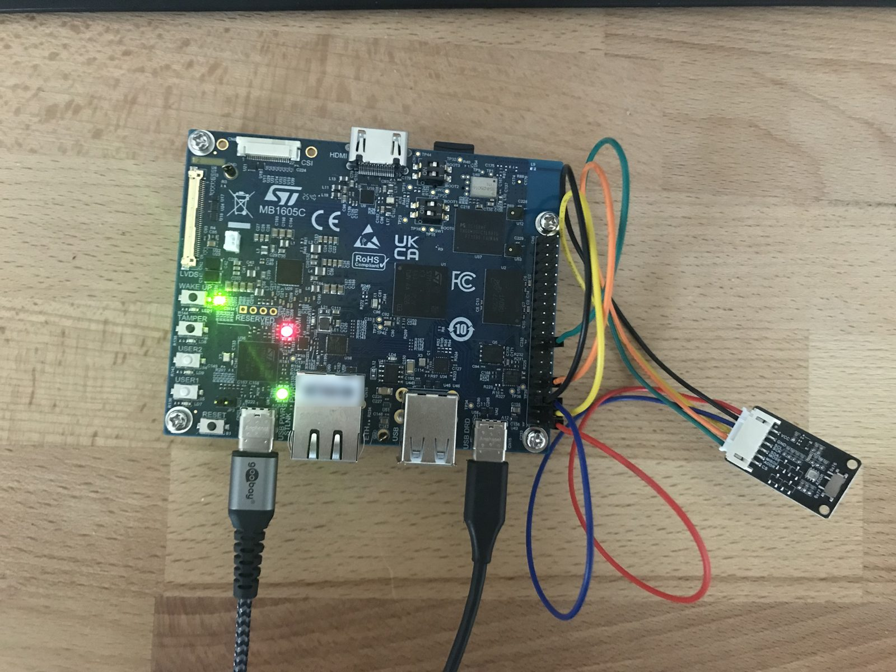

# yocto-stm32mp2-ota

[](https://github.com/dattran96/yocto-stm32mp2-ota/actions/workflows/ci.yml)

A production-style Embedded Linux platform for the **STM32MP257F-DK**, built with Yocto 5.0
"Scarthgap" (LTS) on top of ST's BSP: a signed boot chain, a read-only rootfs checked by
dm-verity, A/B over-the-air updates with RAUC from a hawkBit server, and CI with SBOM, CVE and
license gates. Features were tested on the board unless marked otherwise.

<p align="center">
  
  <br><em>The STM32MP257F-DK running this image, a BME280 on the 40-pin header (I2C8)</em>
</p>

## Features

**Secure boot**
- TF-A and FIP (BL31, OP-TEE, U-Boot) signed with my own keys, checked by TF-A's chain of trust;
  a changed U-Boot is refused ([guide 13](docs/13-secure-boot.md))
- Kernel, device tree and initramfs in one signed FIT; U-Boot carries the public key inside the
  FIP and refuses unsigned images ([12h](docs/12h-signed-fit.md))
- A/B boot logic built into U-Boot; the environment accepts only RAUC's three variables

**Verified, read-only system**
- Rootfs read-only from the first moment of boot ([15](docs/15-read-only-rootfs.md))
- Own initramfs opens the rootfs with dm-verity; the root hash is inside the signed FIT, so a
  changed block stops the boot ([16](docs/16-dm-verity-boot.md))
- Persistent `/data` partition for everything that must change: RAUC status, SSH host key,
  journal, WiFi credentials, device token ([14](docs/14-data-partition.md))

**Over-the-air updates**
- RAUC with two slot groups (boot partition + rootfs), signed `verity` bundles, attempt counters
  and automatic rollback ([12](docs/12-rauc-ota.md))
- A slot is marked good only after a health check; systemd watchdog for the main service;
  anti-rollback with `min-bundle-version` ([19](docs/19-robust-updates.md); built, the
  failure cases are not tested on the board yet)
- Updates from an Eclipse hawkBit server over WiFi with `rauc-hawkbit-updater`; one script
  uploads and assigns a bundle ([23](docs/23-hawkbit.md))

**Build and CI**
- One-command reproducible build with kas, all layers pinned ([17](docs/17-kas-build.md))
- Development and release configurations; release without `debug-tweaks`, SSH keys only
  ([18](docs/18-release-hardening.md))
- GitHub Actions: lint and parse check on GitHub's runners; full image and bundle build on a
  self-hosted runner, signed with a CI test key ([20](docs/20-ci.md)); a release workflow for
  tags with SDK is written, its first full run is still open
- SPDX SBOM, CVE report and license manifest from every build; CI fails on a new critical CVE or
  a GPLv3-only package ([21](docs/21-sbom-cve-licenses.md))

**BSP, kernel and drivers**
- Board bring-up with `meta-st-stm32mp`, including an OP-TEE panic traced back to a GPU driver
  ([11](docs/11-stm32mp2-bringup.md))
- Kernel configuration fragments for ST's kernel recipe, an out-of-tree kernel module
  ([9](docs/09-kernel.md))
- Bosch BME280 on the 40-pin header: bus and pins traced from the manual through OP-TEE's
  resource isolation and pinctrl to the board device tree; a kernel patch enables `i2c8` and
  describes the sensor, values through IIO ([24](docs/24-i2c-sensor.md))
- WiFi (CYW43439) with systemd-networkd and `wpa_supplicant`; credentials only on `/data`
  ([22](docs/22-wifi.md))

## Architecture

**Chain of trust**
```
 Boot ROM + OTP fuses (key hash)                                  inside the chip
        │ checks
        ▼
 TF-A BL2 (signed)                                                fsbla1 / fsbla2
        │ checks the certificate chain
        ▼
 FIP: BL31, OP-TEE, U-Boot (+ FIT public key, A/B logic)          fip-a
        │ checks the FIT signature
        ▼
 FIT: kernel + device tree + initramfs (root hash)                bootfs1 / bootfs2
        │ initramfs: veritysetup with the root hash
        ▼
 rootfs, read-only, every block checked by dm-verity              rootfs1 / rootfs2
        │ RAUC checks bundle signatures with its CA
        ▼
 signed update bundles
```

**SD card layout and A/B slots** (from the generated flash layout)

| # | Partition | Size | Contents | Written by RAUC |
|---|---|---|---|---|
| p1, p2 | `fsbla1`, `fsbla2` | 256 KB each | TF-A BL2, signed; two copies for the boot ROM | no |
| p3, p4 | `metadata1`, `metadata2` | 256 KB each | firmware-update metadata: which FIP TF-A loads | no |
| p5, p6 | `fip-a`, `fip-b` | 4 MB each | FIP: BL31, OP-TEE, U-Boot, signed (`fip-b` empty) | no |
| p7 | `u-boot-env` | 512 KB | only `BOOT_ORDER`, `BOOT_A_LEFT`, `BOOT_B_LEFT` | the variables |
| p8, p9 | `bootfs1`, `bootfs2` | 64 MB each | signed FIT: kernel, device tree, initramfs with the root hash | yes |
| p10, p11 | `rootfs1`, `rootfs2` | 4 GB each | read-only rootfs with its dm-verity hash tree | yes |
| p12 | `userfs` | rest of the card | `/data`: RAUC status, keys, credentials, journal | never |

```
slot A = bootfs1 + rootfs1          slot B = bootfs2 + rootfs2
```

**Update flow**
```
 build (PC or CI) ──signed .raucb──► hawkBit server ◄── board polls every 30 s
                                                          │ download, check sha256
                                                          ▼
                                    rauc install into the other slot (signature, dm-verity)
                                                          │ reboot
                                                          ▼
                    U-Boot boots the new slot (3 attempts) ──fail──► back to the old slot
                                                          │
                                                          ▼
                                    health check passes ──► slot marked good
```

## Tested on the board

| Test | Result |
|---|---|
| U-Boot changed by one byte in the signed FIP | TF-A refuses it (`Failed to load image id 5 (-80)`) |
| Unsigned FIT | U-Boot refuses to boot it |
| One block of the rootfs changed | `data block ... is corrupted`, reboot, fallback to the other slot |
| Update interrupted during the first boots | RAUC/U-Boot fall back to the previous slot |
| OTA from hawkBit over WiFi | 73 MB in 14 s, installed into the other slot, rebooted, reported back |
| `fw_setenv bootcmd ...` from Linux | ignored by U-Boot's locked environment |
| BME280 on `i2c8` | chip ID `0x60` read, temperature, pressure and humidity in IIO |

## Quick start

On a Linux host set up for Yocto
([requirements](https://docs.yoctoproject.org/5.0/ref-manual/system-requirements.html)):
```bash
git clone https://github.com/dattran96/yocto-stm32mp2-ota.git meta-mylayer
python3 -m venv ~/kas-venv && ~/kas-venv/bin/pip install kas
cp meta-mylayer/kas/signing.yml.example meta-mylayer/kas/signing.yml   # set your key paths
mkdir kas-work && cd kas-work
read -rs SIGN_KEY_PASS; export SIGN_KEY_PASS
~/kas-venv/bin/kas build ../meta-mylayer/kas/stm32mp25-disco.yml:../meta-mylayer/kas/debug.yml:../meta-mylayer/kas/signing.yml
```
- First flash with STM32CubeProgrammer: [guide 16](docs/16-dm-verity-boot.md) (full flash).
- Updates: `rauc install` from a USB stick ([12](docs/12-rauc-ota.md)) or hawkBit
  ([23](docs/23-hawkbit.md)).
- Keys, passwords, WiFi credentials and device tokens are never in this repository.

## Repository layout

| Path | Contents |
|---|---|
| `conf/distro/` | `mydistro`: poky with systemd, RAUC, version for anti-rollback |
| `kas/` | pinned build, development and CI settings, signing example |
| `recipes-bsp/` | U-Boot: A/B logic, locked environment, `fw_env.config`; TF-M script fix |
| `recipes-core/images/` | `my-image` (read-only, dm-verity), `my-initramfs`, `my-bootfs` |
| `recipes-core/bundles/` | signed RAUC bundle with both slot images |
| `recipes-core/` | RAUC config, `/data` mount, health check, SSH key, Dropbear, initramfs module |
| `recipes-connectivity/` | WiFi: networkd, `wpa_supplicant`, credentials on `/data` |
| `recipes-support/` | `rauc-hawkbit-updater` with its config on `/data` |
| `recipes-kernel/` | kernel fragments, device tree patch, FIT with initramfs, `mymod` |
| `hawkbit/` | hawkBit server and UI for Docker |
| `scripts/` | SBOM and CVE summaries, CI gates, hawkBit upload |
| `.github/` | workflows, CVE baseline, license allow list |
| `docs/` | a guide per step, checks with expected output |

## Documentation

- [Guides](docs/README.md): every step with the commands for the PC and the board and the output
  to expect
- [Checks](docs/verify.md): commands to verify build results and the board
- [Learning log](docs/learning-log.md): how the project was built step by step, with the
  problems on the way and how they were solved
- [Roadmap](docs/roadmap.md): done and next

## Next

- Own BME280 driver as an out-of-tree module (`probe()`, `regmap`, IIO)
- Report OTA success only after the health check; HTTPS to the update server
- Encrypted `/data` with a key from OP-TEE
- Last: the key hash into the OTP fuses (irreversible)
